# DepoSafe - System Architecture & Traceability Matrix

## 1. System Architecture Diagram

```mermaid
flowchart TD
    subgraph ClientLayer ["Client Layer (Next.js 14 App Router + TypeScript + Tailwind)"]
        UI_Inst["Institution Portal<br/>(Self-Declaration & Upload)"]
        UI_Off["Verification Officer Portal<br/>(4-Level Provenance & Forensics)"]
        UI_Reg["Regional Officer & Admin<br/>(Workload, Rules & Demo Clock)"]
        UI_CA["Competent Authority<br/>(Release & Refund Approval)"]
    end

    subgraph APILayer ["API & Business Gateway (FastAPI Python 3.11)"]
        AUTH["Auth & RBAC Module<br/>(JWT + Argon2)"]
        FDR_SVC["FDR Lifecycle Service<br/>(State Machine Enforced)"]
        PROV_SVC["4-Level Provenance Engine<br/>(Zero Black-Box Tracking)"]
        RULES_ENG["Regulation Rules Engine<br/>(APH 2024-27 Versioned)"]
        AUDIT_SVC["Append-Only Hash Chain<br/>H_n = SHA256(H_n-1 || e_n)"]
        CLOCK_SVC["Controllable Demo Clock<br/>(Live Simulation Advance)"]
    end

    subgraph IntelligenceLayer ["Document AI & Forensic Analysis Engine"]
        PDF_PARSER["PyMuPDF Layout Extractor<br/>(Coordinates & Text BBoxes)"]
        PHASH["Perceptual Image Hash<br/>(imagehash.phash)"]
        META_SCAN["PDF Producer Scanner<br/>(Canva/Photoshop Detector)"]
        BLUR_SCAN["OpenCV Laplacian Blur Check"]
        GRAPH_ENG["NetworkX Relationship Graph<br/>(Anomaly & Cluster Detection)"]
    end

    subgraph StorageLayer ["Data & Storage Layer"]
        PG["PostgreSQL 16 Primary DB<br/>(16 Versioned Tables)"]
        MINIO["MinIO S3 / Encrypted Storage<br/>(Versioned Immutable PDFs)"]
        REDIS["Redis 7 Broker & Cache"]
    end

    subgraph BackgroundScheduler ["Background Automation & Scheduler"]
        CELERY_BEAT["Celery Beat Scheduler<br/>(Hourly Maturity Escalation)"]
        CELERY_WORKER["Celery Worker<br/>(T-15 Alert & Notification Dispatch)"]
    end

    subgraph ExternalAdapters ["Integration Adapter Layer"]
        BANK_ADAPTER["BankVerificationAdapter<br/>(Mock CBS SFMS / Manual Evidence)"]
        NOTIF_ADAPTER["NotificationChannel<br/>(Email / SMS / Webhook)"]
    end

    UI_Inst --> AUTH
    UI_Off --> AUTH
    UI_Reg --> AUTH
    UI_CA --> AUTH

    AUTH --> FDR_SVC
    FDR_SVC --> PROV_SVC
    FDR_SVC --> RULES_ENG
    FDR_SVC --> AUDIT_SVC
    FDR_SVC --> CLOCK_SVC

    FDR_SVC --> PDF_PARSER
    PDF_PARSER --> PHASH
    PDF_PARSER --> META_SCAN
    PDF_PARSER --> BLUR_SCAN
    FDR_SVC --> GRAPH_ENG

    FDR_SVC --> BANK_ADAPTER
    FDR_SVC --> NOTIF_ADAPTER

    FDR_SVC --> PG
    FDR_SVC --> MINIO
    
    CELERY_BEAT --> REDIS
    CELERY_WORKER --> REDIS
    CELERY_WORKER --> PG
    CELERY_WORKER --> AUDIT_SVC
```

---

## 2. Traceability Matrix: 10 Expected Solution Capabilities

| # | Expected Solution Capability | Backend Module | Frontend Screen / Component | Unit & E2E Test | 90-Sec Demo Step |
|---|---|---|---|---|---|
| **1** | **FDR Registration & Tracking** | `backend/app/api/fdrs.py`, `models/deposafe_models.py` (`FDR`) | `FDRRegistryView.tsx`, `CreateFDRModal.tsx` | `test_fdr_list_and_provenance` in `test_api_and_workflows.py` | Step 1: Open Registry, view deposit details |
| **2** | **Document Intelligence & AI Extraction** | `backend/app/services/document_ai.py` (PyMuPDF) | `FDRDetailModal.tsx` (AI Extracted column) | `test_generate_and_extract_compliant_fdr` in `test_document_ai.py` | Step 2: View extracted values with confidence % |
| **3** | **Document Forensics & Integrity** | `document_ai.py` (SHA256, pHash, Canva/Photoshop tool detector, blur) | `FDRDetailModal.tsx` (Document Forensics Tab) | `test_generate_and_detect_tampered_metadata` in `test_document_ai.py` | Step 3: Inspect SHA256, pHash and Canva tampering flag |
| **4** | **Four-Level Field Provenance** | `deposafe_models.py` (`FieldProvenance`), `fdrs.py` | `FDRDetailModal.tsx` (4-Level Matrix) | `test_critical_flow_1_provenance_and_bank_adapter` in `test_e2e_flows.py` | Step 4: Examine Submitted vs AI vs Bank vs Officer columns |
| **5** | **Bank Verification Adapter Pattern** | `backend/app/adapters/bank_adapter.py` (`BankVerificationAdapter`) | `FDRDetailModal.tsx` (Actions &rarr; Simulate Bank Verification) | `test_bank_verification_simulation_adapter` in `test_api_and_workflows.py` | Step 5: Click Simulate Bank CBS, verify disclaimer watermark |
| **6** | **Explainable Advisory Risk Engine** | `backend/app/services/risk_engine.py` (Review Priority Indicator) | `FDRDetailModal.tsx` (Review Flags & Officer Override Modal) | `test_critical_flow_2_risk_explainability_and_officer_override` in `test_e2e_flows.py` | Step 6: View explainable flag, perform officer override with reason |
| **7** | **Regulation-Aware Compliance Engine** | `backend/app/rules/compliance_engine.py` (`APH-2024-27.v1`) | `RulesConfigView.tsx`, `FDRDetailModal.tsx` (Compliance Tab) | `evaluate_fdr_compliance` unit checks | Step 7: View APH Handbook versioned checks & placeholder norms |
| **8** | **Relationship Graph** | `backend/app/services/relationship_graph.py` (NetworkX) | `RelationshipGraphView.tsx` (React Flow canvas) | `build_ecosystem_networkx_graph` test assertions | Step 8: View React Flow canvas, cross-institution trust links |
| **9** | **Predictive Workload & Controllable Clock** | `backend/app/services/demo_clock.py`, `workload_service.py` | `Header.tsx` (Demo Clock Bar), `DashboardView.tsx` (Forecast Chart) | `test_critical_flow_3_demo_clock_renewal_and_release` in `test_e2e_flows.py` | Step 9: Click +30 Days, observe maturity queue live update |
| **10** | **Release Gating & Non-Destructive Renewal** | `fdr_state_machine.py`, `fdrs.py` (`renew`, `authorize-release`) | `FDRDetailModal.tsx` (Renew & Authorize Release) | `test_fdr_renewal_creates_linked_successor_and_supersedes`, `test_release_authorization_role_enforcement` | Step 10: Switch to Competent Authority, authorize release order |
| **Bonus** | **Cryptographic Hash Chain Audit** | `backend/app/services/audit_service.py` ($H_n = \text{SHA256}(H_{n-1} \parallel e_n)$) | `AuditLedgerView.tsx` | `test_audit_ledger_verification` in `test_api_and_workflows.py` | Step 11: 1-click verify all blocks untampered |
| **Bonus** | **Empirical Evaluation Harness** | `backend/app/evaluation/harness.py` | `EvaluationHarnessView.tsx` | `test_evaluation_harness_api` | Step 12: Run live benchmark: 100% F1, ~28ms latency |

