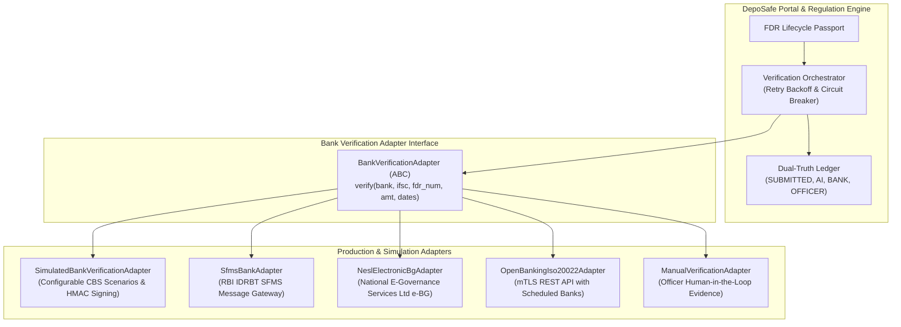

# DepoSafe Bank Integration Architecture & Enterprise Adapter Specification
## AICTE Security Deposit / FDR Intelligence & Management Portal

> [!NOTE]
> In prototype and hackathon environments, all bank interactions use `SimulatedBankVerificationAdapter` and are strictly watermarked with **`SIMULATED, not a real bank verification`**. This document details how real-world authorized banking gateways, SFMS networks, and e-BG repositories plug into DepoSafe in production.

---

### 1. Architectural Overview

DepoSafe decouples the AICTE Regulation Bureau lifecycle workflows from heterogeneous Core Banking Systems (CBS) using the **Adapter Pattern** via the abstract `BankVerificationAdapter` interface.



---

### 2. Standardized Integration Protocols

Real bank verifications operate across three sanctioned enterprise mechanisms in India:

#### 2.1 Structured Financial Messaging System (SFMS) via IDRBT
- **Standard**: RBI Institute for Development and Research in Banking Technology (IDRBT).
- **Message Formats**:
  - `IFN 760`: Issue of Bank Guarantee / Fixed Deposit Receipt with AICTE Lien Marking.
  - `IFN 767`: Amendment / Renewal of Existing Instrument.
  - `IFN 769`: Advice of Release / Cancellation of Joint Lien to AICTE Competent Authority.
- **Payload Structure**: Structured ISO 15022 / 20022 electronic messages transmitted over secured leased lines or MPLS VPN.

#### 2.2 National E-Governance Services Ltd (NeSL) e-BG Repository
- **Standard**: Digital Document Execution (DDE) and e-Bank Guarantee / FDR lien registry.
- **Authentication**: API integration with NeSL Central Repository using XML/JSON signed by authorized bank digital signatures (DSC Class 3).
- **Benefits**: Real-time tamper-evident verification; eliminates paper forging entirely.

#### 2.3 Direct Core Banking Open APIs (ISO 20022 / Open Banking)
- **Standard**: RESTful HTTPS with mutual TLS (mTLS) and X.509 PKI certificates.
- **Payloads**: Request signed using SHA-256 with RSA/ECDSA; response carries bank digital seal.

---

### 3. Step-by-Step Guide: Implementing a Production Bank Adapter

To connect an authorized bank (e.g., State Bank of India, Punjab National Bank, HDFC Bank), implement a concrete class inheriting from `BankVerificationAdapter`:

```python
import requests
from typing import Dict, Any, Optional
from datetime import datetime
from backend.app.adapters.bank_adapter import BankVerificationAdapter

class SbiEnterpriseCbsAdapter(BankVerificationAdapter):
    """
    Production adapter connecting to State Bank of India Core Banking Gateway
    via secure mTLS and PKI signed JSON payloads.
    """
    def __init__(self, api_endpoint: str, client_cert_path: str, client_key_path: str):
        self.endpoint = api_endpoint
        self.cert = (client_cert_path, client_key_path)

    def verify(
        self,
        bank: str,
        branch_ifsc: str,
        fdr_number: str,
        amount: float,
        issue_date: str,
        maturity_date: str,
        scenario: Optional[str] = None
    ) -> Dict[str, Any]:
        payload = {
            "regulator": "AICTE",
            "ifsc": branch_ifsc,
            "fdrNumber": fdr_number,
            "expectedAmount": amount,
            "maturityDate": maturity_date,
            "requestTimestamp": datetime.utcnow().isoformat()
        }

        # Outbound mTLS call to authorized banking gateway
        response = requests.post(
            f"{self.endpoint}/v1/instruments/verify-lien",
            json=payload,
            cert=self.cert,
            timeout=5.0
        )
        response.raise_for_status()
        cbs_data = response.json()

        # Check for field mismatches
        diffs = {}
        if cbs_data.get("maturityDate") != maturity_date:
            diffs["maturity_date"] = {
                "expected": maturity_date,
                "bank_record": cbs_data.get("maturityDate"),
                "discrepancy": "Maturity date in CBS differs from institution declaration"
            }

        is_passed = (len(diffs) == 0 and cbs_data.get("lienMarked") is True)

        return {
            "status": "AVAILABLE_CHECKS_PASSED" if is_passed else ("MISMATCH" if diffs else "NOT_CONFIRMED"),
            "wording": "available checks passed" if is_passed else "not confirmed",
            "returned_fields": {
                "bank_name": bank,
                "branch_ifsc": branch_ifsc,
                "fdr_number": fdr_number,
                "amount": cbs_data.get("principalAmount"),
                "issue_date": cbs_data.get("issueDate"),
                "maturity_date": cbs_data.get("maturityDate"),
                "lien_marked_to": cbs_data.get("beneficiaryName")
            },
            "diffs": diffs,
            "source": "SBI_CBS_ENTERPRISE_GATEWAY",
            "timestamp": datetime.utcnow().isoformat(),
            "simulated": False,
            "watermark": "OFFICIAL PRODUCTION CBS VERIFICATION",
            "api_reference_id": cbs_data.get("transactionReference"),
            "signature": response.headers.get("X-Bank-Digital-Signature")
        }
```

---

### 4. Circuit Breaker & Fallback Guarantees

When third-party bank gateways encounter network latency or scheduled maintenance:
1. **Exponential Retries**: `VerificationOrchestrator` attempts up to 3 retries with backoff ($0.5s \times 2^k$).
2. **Circuit Breaker**: If failures exceed 3 consecutive errors, the circuit breaker trips to `OPEN`, preventing service starvation and fast-failing downstream requests.
3. **Pending Queue**: Unconfirmed instruments are queued into `verification_queue` for automated re-polling.
4. **Human-in-the-Loop Fallback**: If the bank gateway remains unreachable, provenance is flagged `SOURCE_UNAVAILABLE` and routed to the assigned Verification Officer for manual verification using physical branch visit reports or signed bank confirmation letters.

