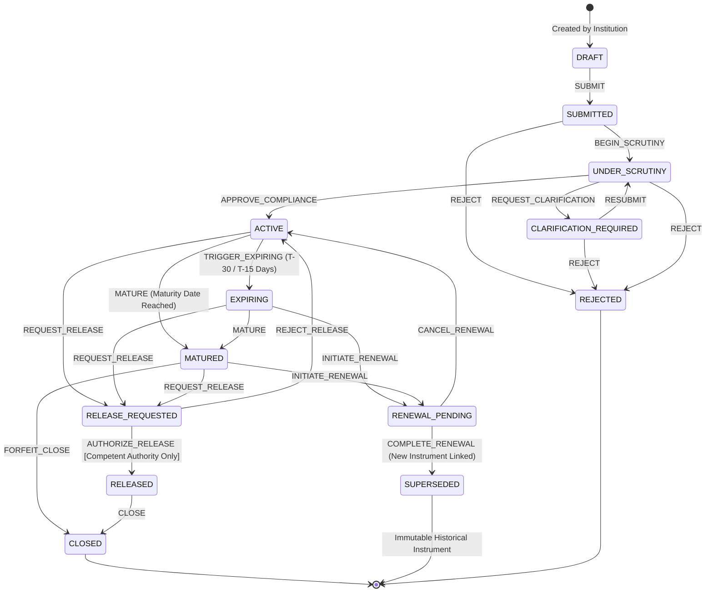
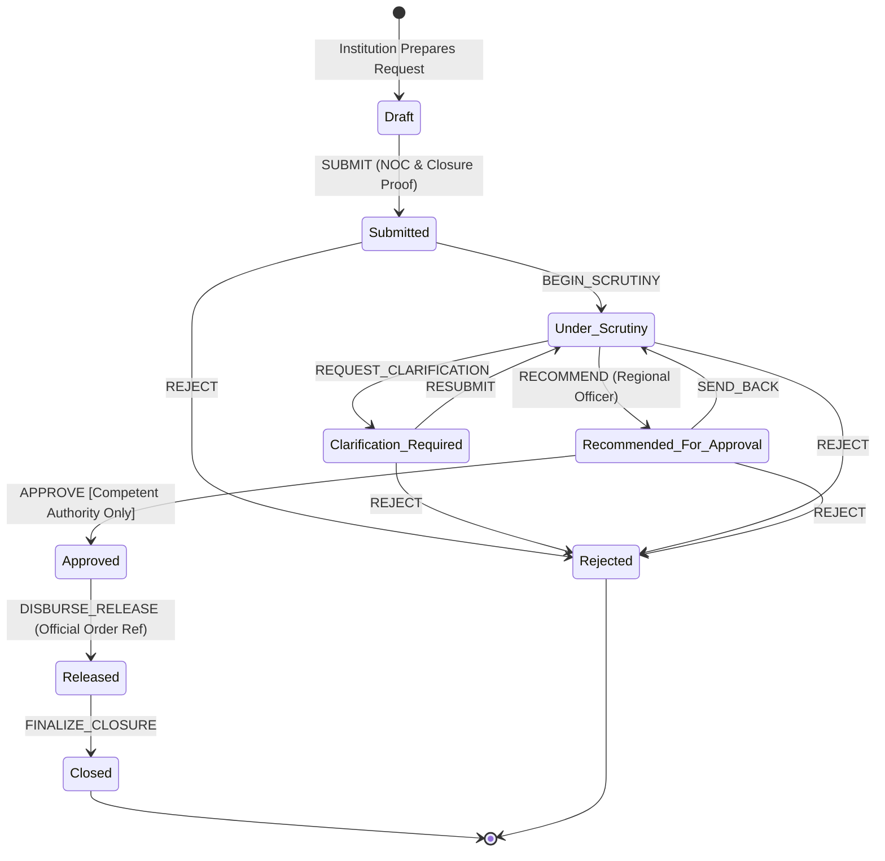

# DepoSafe - State Machine Architecture & Transitions

This document defines the formal state machines governing the AICTE Security Deposit lifecycle and release approval workflow.

---

## 1. FDR Lifecycle State Machine

### Transition Guards & Invariants
1. **SUPERSEDED State**: An instrument that is superseded by a renewal becomes immutable. It can never be edited, deleted, or resurrected.
2. **Release Authorization Guard**: The `AUTHORIZE_RELEASE` transition can **only** be triggered by the `COMPETENT_AUTHORITY` role.
3. **Invalid Transitions**: Any transition not defined above raises `InvalidStateTransitionError`.

---

## 2. Release & Refund Workflow State Machine

